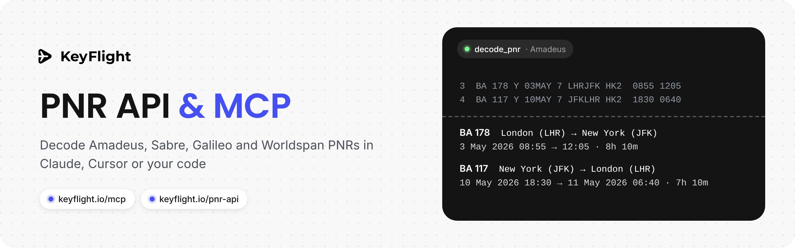
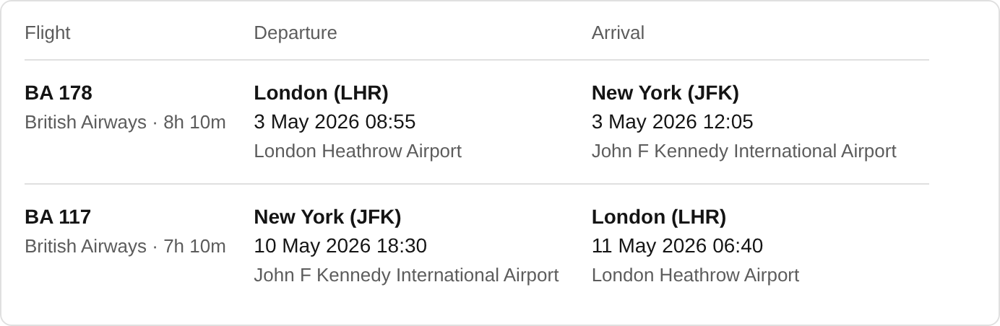

<p align="center"></p>

# KeyFlight PNR Converter: MCP server and PNR API

Paste a raw booking from a GDS (Amadeus, Sabre, Galileo, Worldspan) into Claude, Cursor or another AI assistant and get a readable itinerary, the booking as JSON, or a PRO ticket PDF.

KeyFlight runs a hosted [Model Context Protocol](https://modelcontextprotocol.io/) server at `https://keyflight.io/mcp` and an HTTP API at `https://keyflight.io/api/v1/pnr/decode`. Both use the same decoder as the free [PNR converter](https://keyflight.io/tickets/pnr) on keyflight.io.

This repository holds the documentation and examples. The server itself is hosted by KeyFlight: there is nothing to install or run. Full reference: [keyflight.io/pnr-api](https://keyflight.io/pnr-api).

**Who it is for:** travel agents and agencies who work with GDS bookings, and developers who add PNR decoding to a booking tool, CRM, chat bot or e-mail flow.

- [Get an API key](#get-an-api-key)
- [Connect an AI assistant (MCP)](#connect-an-ai-assistant-mcp)
- [MCP tools](#mcp-tools)
- [PNR API over HTTP](#pnr-api-over-http)
- [Limits](#limits)
- [Errors](#errors)
- [Supported GDS formats](#supported-gds-formats)

## Get an API key

The MCP server and the PNR API take the same key, `kfp_` followed by 43 letters, digits, `-` and `_`.

1. Get the [KeyFlight subscription](https://keyflight.io/subscription) (the subscription for travel agents).
2. On the same page use **"Already subscribed?"**, open the link we e-mail you and press **"Create API key"**.
3. Copy the key: it is shown once. A subscription can have 2 keys at a time; you revoke a key on the same page.

While the subscription is not active, the key answers `403 subscription_inactive`. There is no free tier for the API or the MCP server. The [PNR converter](https://keyflight.io/tickets/pnr) on the website is free for everyone, with no key.

## Connect an AI assistant (MCP)

| | |
| --- | --- |
| Server URL | `https://keyflight.io/mcp` |
| Transport | Streamable HTTP, `POST` only, no sessions and no server-sent event stream |
| Authentication | header `Authorization: Bearer kfp_…` |
| Protocol versions | `2025-06-18`, `2025-03-26`, `2024-11-05` |

### Claude Code

```bash
claude mcp add --transport http keyflight https://keyflight.io/mcp --header "Authorization: Bearer kfp_…"
```

### Cursor (`.cursor/mcp.json`)

```json
{
  "mcpServers": {
    "keyflight": {
      "url": "https://keyflight.io/mcp",
      "headers": {
        "Authorization": "Bearer kfp_…"
      }
    }
  }
}
```

### Claude Desktop (`claude_desktop_config.json`, needs Node.js)

Claude Desktop connects through [`mcp-remote`](https://www.npmjs.com/package/mcp-remote):

```json
{
  "mcpServers": {
    "keyflight": {
      "command": "npx",
      "args": [
        "-y",
        "mcp-remote",
        "https://keyflight.io/mcp",
        "--header",
        "Authorization: Bearer kfp_…"
      ]
    }
  }
}
```

Then ask, for example: *"Decode this PNR and make a PRO ticket with a price of 850 EUR"* and paste the booking.

Other clients: any MCP client that supports Streamable HTTP and custom headers. Requests sent from web pages of other sites (with a browser `Origin` header) are refused with `403 origin_not_allowed`, so connect from a desktop app, a CLI or your server. Without a client, see [`examples/mcp/raw-jsonrpc.sh`](examples/mcp/raw-jsonrpc.sh): one JSON-RPC message per `POST`, JSON back.

## MCP tools

### `decode_pnr`: decode a PNR

Turns a raw PNR into a readable itinerary (text) and structured JSON: passengers, flights, airports, terminals, local times, flight duration, airline locators.

| Argument | Type | Default | Description |
| --- | --- | --- | --- |
| `text` | string, required | | The PNR as the GDS shows it, up to 20,000 characters. The format is recognised from the text. |
| `view` | `table`, `lines2`, `lines3`, `whatsapp` | `table` | Layout of the itinerary text. |
| `time_format` | `"24"`, `"12"` | `"24"` | 24 or 12 hour time. |
| `date_format` | `"short"`, `"numeric"` | `"short"` | `short`: 3 May 2026, `numeric`: 03.05.2026. |

**Returns** the itinerary text, then `JSON:` and the same JSON as the [PNR API answer](#response). Clients that read `structuredContent` get that JSON there.

Each decode that finds flights counts towards the monthly decodes of the subscription, like an API call. A text without flights returns an error and does not count. When the decodes of the month are used up, the tool returns an error until the 1st (UTC).

### `make_ticket`: make a PRO ticket PDF

Makes a PRO ticket PDF (PNR, airline logos, class, optional price) from a raw PNR and returns a link to the PDF. Included in the KeyFlight subscription.

> The ticket is a document for the traveller: it is not an airline ticket and its PNR is not checked against airline systems.

| Argument | Type | Default | Description |
| --- | --- | --- | --- |
| `text` | string, required | | The PNR, up to 20,000 characters. Every flight needs a date and times. |
| `passengers` | array of strings, up to 20 | the names in the PNR | Passenger names as on the ticket, e.g. `"SMITH/JOHN MR"`. |
| `pnr` | string | the code in the text, or a random one | Booking code printed on the ticket, 5–8 letters and digits. |
| `booking_class` | `Economy`, `Premium Economy`, `Business`, `First Class` | the cabin of the first flight's booking class | Class on the ticket. |
| `price` | string | no price on the ticket | Total price printed on the ticket, e.g. `"1200.50"`. |
| `currency` | string, up to 10 characters | `"$"` | Currency next to the price, e.g. `"USD"`, `"€"`. |
| `logo` | `none`, `expedition` | `none` | Logo in the ticket header. |
| `time_format` | `"24"`, `"12"` | `"24"` | 24 or 12 hour time. |
| `date_format` | `"short"`, `"numeric"` | | `short` or `numeric`. |

**Returns** a line `PRO ticket PDF: https://keyflight.io/tickets/….pdf` with the PNR, the number of flights and the passengers, and as `structuredContent`:

```json
{ "url": "https://keyflight.io/tickets/….pdf", "pnr": "PQ7XNR", "passengers": ["JOHNSON JOHN", "JOHNSON JANE"], "segments": 2 }
```

Tickets do not count towards the monthly decodes; one key can make up to 30 tickets an hour.

Errors (no flights in the text, a flight without a date or time, no passenger names, a wrong `pnr` or option, more than 30 tickets in an hour) come back as tool results with `isError: true`, so the assistant can read them and fix the call.

## PNR API over HTTP

`POST https://keyflight.io/api/v1/pnr/decode` with `Content-Type: application/json` and `Authorization: Bearer kfp_…`. The body is `{ "text": "…", "options": { … } }`. The HTTP API returns data and the itinerary as text and HTML; PRO ticket PDFs come from the MCP tool [`make_ticket`](#make_ticket-make-a-pro-ticket-pdf). The examples below send the Amadeus booking from [`examples/pnr-amadeus.txt`](examples/pnr-amadeus.txt).

### curl

```bash
curl https://keyflight.io/api/v1/pnr/decode \
  -H "Authorization: Bearer $KEYFLIGHT_API_KEY" \
  -H "Content-Type: application/json" \
  -d '{
  "text": "RP/LHRBA/LHRBA            BA/BA  26APR26/1200Z   PQ7XNR\nPQ7XNR/BA QLHR 03MAY\n1.JOHNSON JOHN\n2.JOHNSON JANE\n3  BA 178 Y 03MAY 7 LHRJFK HK2  0855 1205  03MAY  E  BA/PQ7XNR\n4  BA 117 Y 10MAY 7 JFKLHR HK2  1830 0640  11MAY  E  BA/PQ7XNR\n5 TKT/TIME LIMIT\n6 OPC LHRBA-10MAY:1900/1S2/Q TKT/T-BA\n7 FA PAX 125-2196837482/ETBA/GBP560.20/03MAY26/LHRBA2104/00390755/S3-4",
  "options": {
    "view": "table"
  }
}'
```

### Node.js 18+

[`examples/api/decode.mjs`](examples/api/decode.mjs):

```js
// Node.js 18+ (fetch is built in), in an ES module or an async function
const text = `RP/LHRBA/LHRBA            BA/BA  26APR26/1200Z   PQ7XNR
PQ7XNR/BA QLHR 03MAY
1.JOHNSON JOHN
2.JOHNSON JANE
3  BA 178 Y 03MAY 7 LHRJFK HK2  0855 1205  03MAY  E  BA/PQ7XNR
4  BA 117 Y 10MAY 7 JFKLHR HK2  1830 0640  11MAY  E  BA/PQ7XNR
5 TKT/TIME LIMIT
6 OPC LHRBA-10MAY:1900/1S2/Q TKT/T-BA
7 FA PAX 125-2196837482/ETBA/GBP560.20/03MAY26/LHRBA2104/00390755/S3-4`;

const response = await fetch('https://keyflight.io/api/v1/pnr/decode', {
  method: 'POST',
  headers: {
    Authorization: `Bearer ${process.env.KEYFLIGHT_API_KEY}`,
    'Content-Type': 'application/json',
  },
  body: JSON.stringify({ text, options: { "view": "table" } }),
});
const data = await response.json();
if (response.ok) {
  data.segments.forEach((s) => console.log(s.airlineCode, s.flightNumber, s.departure.date));
} else {
  console.error(response.status, data.error, data.message);
}
```

### Python

[`examples/api/decode.py`](examples/api/decode.py) (needs `requests`):

```python
import os
import requests

text = """RP/LHRBA/LHRBA            BA/BA  26APR26/1200Z   PQ7XNR
PQ7XNR/BA QLHR 03MAY
1.JOHNSON JOHN
2.JOHNSON JANE
3  BA 178 Y 03MAY 7 LHRJFK HK2  0855 1205  03MAY  E  BA/PQ7XNR
4  BA 117 Y 10MAY 7 JFKLHR HK2  1830 0640  11MAY  E  BA/PQ7XNR
5 TKT/TIME LIMIT
6 OPC LHRBA-10MAY:1900/1S2/Q TKT/T-BA
7 FA PAX 125-2196837482/ETBA/GBP560.20/03MAY26/LHRBA2104/00390755/S3-4"""

response = requests.post(
    "https://keyflight.io/api/v1/pnr/decode",
    headers={"Authorization": f"Bearer {os.environ['KEYFLIGHT_API_KEY']}"},
    json={"text": text, "options": { "view": "table" }},
    timeout=30,
)
data = response.json()
if response.ok:
    for s in data["segments"]:
        print(s["airlineCode"], s["flightNumber"], s["departure"]["date"])
else:
    print(response.status_code, data["error"], data["message"])
```

### Options

| Field | Values | Default |
| --- | --- | --- |
| `text` | Required. The booking as the GDS shows it, up to 20,000 characters. | |
| `options.view` | `table`, `lines2`, `lines3`, `whatsapp`: the layout of `itinerary`. | `table` |
| `options.timeFormat` | `"24"` (18:30), `"12"` (6:30 PM) | `"24"` |
| `options.dateFormat` | `"short"` (3 May 2026), `"numeric"` (03.05.2026) | `"short"` |
| `options.show.logo` | `true` / `false`. Airline logos (HTML only). | `true` |
| `options.show.airports` | `true` / `false`. Airport names and terminals next to the city. | `true` |
| `options.show.cabin` | `true` / `false`. Cabin and booking class: Economy (Y). | `false` |
| `options.show.status` | `true` / `false`. Segment status: Confirmed, Waitlisted. | `false` |
| `options.show.passengers` | `true` / `false`. Passenger names above the flights. | `false` |
| `options.show.pnr` | `true` / `false`. The booking reference and the airlines' references above the flights. | `false` |

An unknown option or a wrong value answers `400 invalid_option` with the field and the allowed values.

### Response

The full answer to the example above: [`examples/api/response-example.json`](examples/api/response-example.json) (`itinerary.html` shortened). Main fields:

| Field | Meaning |
| --- | --- |
| `pnrCode` | The booking reference found in the text, or `null`. |
| `passengers[].name` | A passenger name as the PNR writes it. |
| `segments[].airlineCode`, `airlineName`, `flightNumber` | Airline and flight number (`"950"` for UA0950). |
| `segments[].bookingClass`, `cabin` | Booking class letter and cabin by it: Economy, Premium Economy, Business, First Class. |
| `segments[].status`, `statusText` | Status code as in the PNR (`"HK2"`) and Confirmed, Waitlisted or the code itself. |
| `segments[].logoUrl` | Airline logo, 64×64 PNG. |
| `segments[].duration` | Flight time in minutes across the two airports' time zones, or `null`. |
| `segments[].distance` | `{ km, miles }` between the airports, or `null`. |
| `segments[].aircraftCode`, `aircraft` | Aircraft type when the PNR shows it, or `null`. |
| `segments[].operatedBy` | Operating airline as the PNR prints it (`OPERATED BY …`), or `null`. |
| `segments[].airlineLocator` | `{ airlineCode, code }`: the airline's own booking reference, or `null`. |
| `segments[].departure`, `arrival` | `code`, `city`, `airport`, `terminal`, local `date` (`YYYY-MM-DD`) and `time` (`HH:MM`). |
| `itinerary` | `view`, `text` and `html` (e-mail HTML with tables and inline styles; `null` for `whatsapp`). |

`itinerary.html` of the example in the `table` view, with `options.show.logo: false`, as the free converter shows it:



## Limits

| Limit | Value |
| --- | --- |
| PNR text | up to 20,000 characters; JSON body up to 100kb |
| Requests per key | 60 a minute on the API and 60 a minute on the MCP server; over it `429 too_many_requests` with `Retry-After` |
| Requests per IP address | 120 a minute |
| Decodes per subscription | 3,000 a calendar month (UTC), both keys together, API and `decode_pnr` together. Only decodes that found flights count. |
| PRO ticket PDFs (`make_ticket`) | 30 an hour per key |

Answers of the HTTP API carry `X-RateLimit-Limit`, `X-RateLimit-Remaining`, `X-RateLimit-Reset` and `X-Monthly-Limit`, `X-Monthly-Remaining`, `X-Monthly-Reset`.

## Errors

PNR API errors are JSON: `{ "error": "<code>", "message": "…" }`.

| Status | `error` | When |
| --- | --- | --- |
| 400 | `invalid_json` | The body is not a JSON object. |
| 400 | `text_required` | `text` is missing or empty. |
| 400 | `invalid_option` | An unknown option or a wrong value. `field` names it, `allowed` lists the values. |
| 401 | `missing_api_key` | No `Authorization: Bearer …` header. |
| 401 | `invalid_api_key` | The key is not valid or was revoked. |
| 403 | `subscription_inactive` | The subscription of the key is not active. |
| 404 | `not_found` | No such endpoint. |
| 405 | `method_not_allowed` | The method is not POST. |
| 413 | `too_long` | The text is longer than 20,000 characters (`max` in the answer). |
| 413 | `payload_too_large` | The body is larger than 100kb. |
| 415 | `unsupported_encoding` | The body is not UTF-8. |
| 422 | `no_flights` | No flights in the text. Does not count towards the monthly limit. |
| 429 | `too_many_requests` | Over the per-minute limit; wait `Retry-After` seconds. |
| 429 | `monthly_limit_reached` | The subscription has used its decodes for this month. |
| 500 | `server_error` | Something went wrong on our side. |
| 503 | `service_unavailable` | The key cannot be checked right now. Try again in a minute. |

Before a tool runs, the MCP server answers in the same JSON: `401 missing_api_key` / `invalid_api_key`, `403 subscription_inactive`, `429 too_many_requests` and `503 service_unavailable`; also `403 origin_not_allowed` for requests from web pages of other sites and `405 method_not_allowed` for anything but `POST`. Inside a tool, errors (the monthly limit too) are tool results with `isError: true`.

## Supported GDS formats

Amadeus (1A), Sabre (1B/1S), Galileo (1G) and Worldspan (1P). Send the booking as the GDS shows it; you don't need to say which system it came from. Example bookings for each system: [Amadeus](https://keyflight.io/pnr-converter-amadeus), [Sabre](https://keyflight.io/pnr-converter-sabre), [Galileo](https://keyflight.io/pnr-converter-galileo), [Worldspan](https://keyflight.io/pnr-converter-worldspan).

## Links

- API and MCP reference: [keyflight.io/pnr-api](https://keyflight.io/pnr-api)
- Free PNR converter (no key): [keyflight.io/tickets/pnr](https://keyflight.io/tickets/pnr)
- KeyFlight subscription for travel agents: [keyflight.io/subscription](https://keyflight.io/subscription)

## License

The examples and documentation in this repository are under the [MIT License](LICENSE). The KeyFlight service is not open source; using it needs a KeyFlight subscription.
